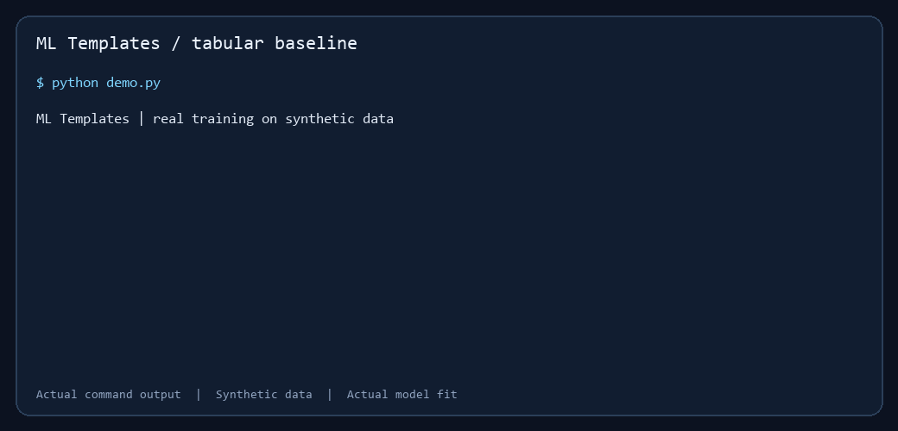

# ML Templates

**Start with a baseline you can run, inspect and trust enough to improve.**

A small tabular classification workflow plus the original collection of ML/NLP reference snippets. The runnable path handles numeric and categorical features, missing values and class imbalance; selects a logistic-regression model using cross-validation; then evaluates a separate holdout. No API, downloaded dataset or GPU is needed.



This animation is rendered from actual commands. The model is really fitted, but the data is generated locally and its scores are **not evidence of real-world model performance**. [Recording and source hashes](docs/demo-recording.json).

## Quickstart

Python 3.11+; the CI matrix checks Python 3.11 and 3.13 on Windows and Linux.

```bash
git clone https://github.com/smgpulse007/ML_Templates.git
cd ML_Templates
python -m venv .venv
```

Activate with `source .venv/bin/activate` on macOS/Linux or `.venv\Scripts\Activate.ps1` in Windows PowerShell. Then:

```bash
python -m pip install -r requirements.txt
python demo.py
python demo.py --json
python -m unittest discover -s tests -v
```

You can also call `.venv/bin/python` or `.venv\Scripts\python.exe` directly without activating the environment. The demo generates 400 synthetic rows with five numeric features, one categorical feature, missing values and an imbalanced binary outcome.

## Bring a CSV

For a table with independent rows and a target column containing both `0` and `1`:

```bash
python tabular_baseline.py --csv your_table.csv --target outcome
```

The CLI prints a JSON report to stdout; it does not save models, upload rows or create an experiment-tracking account. Redirect stdout if you want a local report. Files are limited to 20 MiB, 100,000 rows and 200 columns. Headers must be unique and nonempty. Invalid inputs exit `2` with a generic JSON error that does not echo file contents; argument usage errors also exit `2`.

Features can be numeric or string categories, with missing values. Complex numbers, infinity, dates, boolean feature columns and mixed object types are rejected. Convert these intentionally for your problem first. Missing numeric values use the training median; missing categories use `__missing__`. That literal is reserved for missing categories. Entirely missing numeric features are retained with zero imputation. Unseen categories are ignored at transformation time.

For Python use:

```python
from demo import synthetic_data
from tabular_baseline import run_experiment

result = run_experiment(synthetic_data(), "outcome", seed=42, folds=3)
print(result.report["holdout"])
print(result.search.best_params_)
```

## What the baseline does

1. Removes the target column and makes a seeded, stratified 75/25 train/holdout split.
2. Places imputation, scaling and one-hot encoding inside a scikit-learn pipeline.
3. Searches `C = 0.1, 1, 10` for class-weighted logistic regression using three stratified training folds and average precision.
4. Refits the selected pipeline on the training partition and evaluates the untouched holdout at a fixed `0.5` decision threshold.

The report separates **training CV average precision** from **holdout metrics**: average precision, ROC AUC, balanced accuracy, positive prevalence and a confusion matrix with explicit `[0, 1]` labels. The positive prevalence helps interpret average precision on imbalanced data. Thresholds are not tuned on the holdout. Class-weighted probabilities are not claimed to be calibrated.

This structure follows scikit-learn's [guidance on preprocessing and data leakage](https://scikit-learn.org/stable/common_pitfalls.html). It prevents this template's preprocessing and hyperparameter search from learning from holdout rows. It cannot detect target proxies, repeated entities, duplicates, post-outcome features or inappropriate split strategies in your data. Remove ID/target-leakage columns; use group or temporal splits when rows are dependent. Repeatedly selecting designs based on the same holdout also invalidates its role as a final evaluation.

## Tests and scope

The tests run real fits and inspect the learned preprocessing. They verify fold-training membership, holdout-only categories/outliers, actual metric calculations, input preservation, reproducible splits, missing/nullable features, unknown categories and the CSV CLI. They test correctness of this workflow, not clinical, financial or production validity.

Dependencies are pinned in `requirements.txt` for the Python 3.11 baseline. To refresh them, use `uv pip compile requirements.in --python-version 3.11 --output-file requirements.txt` and rerun the platform matrix. To regenerate the animation, install Pillow and run `python scripts/record_demo.py`; it executes the demo and full focused suite before recording source hashes.

CI validates the runnable path and publishes no package, container or deployment. Historical snippet files are outside the runnable suite.

## Original reference snippets

The original files remain unchanged, including grid-search, XGBoost, TPOT, NLTK, TF-IDF and plotting examples. Many depend on variables, datasets, imports or packages supplied by a surrounding notebook; they are **not standalone programs**. Their older dependencies are not part of the new quickstart.

In particular, `fx_GridSearchCV.py` evaluates trials on `X_test`; do not use that pattern to select hyperparameters against a final test set. Start from `tabular_baseline.py` for a complete runnable tuning workflow, and adapt its split and metric to the real problem.

## License and contributions

The earlier README referenced an MIT file that is absent from the repository. No license grant is inferred here; establish a license before redistributing code. Dependencies keep their own licenses.

For a proposed runnable template, include a synthetic example, focused behavior tests, explicit data/split assumptions, and the command a fresh checkout can execute. [Open an issue](https://github.com/smgpulse007/ML_Templates/issues) with a reproducible problem or proposal.

